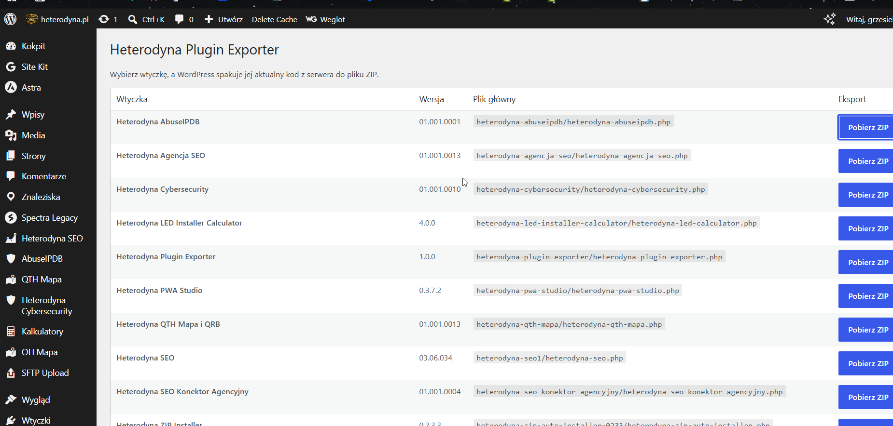

# Heterodyna Plugin Exporter

### Eksport zainstalowanych wtyczek WordPress do pliku ZIP

**Heterodyna Plugin Exporter** to prosta i bardzo przydatna wtyczka dla WordPressa. Pozwala pobrać aktualny kod dowolnej zainstalowanej wtyczki bez ręcznego wchodzenia na serwer.

W praktyce działa to bardzo prosto: wchodzisz w **Narzędzia → Heterodyna Plugin Exporter**, wybierasz wtyczkę z listy i klikasz **Pobierz ZIP**. WordPress pakuje aktualny kod tej wtyczki z serwera i od razu pobierasz gotowe archiwum ZIP.

---

## Do czego to się przydaje?

Ta wtyczka sprawdza się wtedy, gdy chcesz:

- odzyskać kod wtyczki z działającej strony,
- zrobić szybki eksport własnej wtyczki,
- przygotować paczkę do publikacji na GitHubie,
- zachować kopię aktualnej wersji pluginu,
- pobrać kod bez logowania przez FTP albo panel hostingu.

---

## Jak używać?

1. Zainstaluj i aktywuj wtyczkę.
2. W WordPressie przejdź do **Narzędzia → Heterodyna Plugin Exporter**.
3. Na liście wybierz wtyczkę, którą chcesz wyeksportować.
4. Kliknij **Pobierz ZIP**.
5. Otrzymasz archiwum z aktualnym kodem tej wtyczki.

---

## Jak to działa?

Wtyczka odczytuje listę zainstalowanych pluginów z WordPressa, a następnie po kliknięciu eksportu pakuje wybrany katalog wtyczki do pliku ZIP. W przypadku wtyczek jednoplikowych eksportuje po prostu ten jeden plik PHP.

Nie modyfikuje eksportowanej wtyczki i działa tylko dla administratora z uprawnieniem `manage_options`.

---

## Ważne informacje

- eksport wymaga rozszerzenia PHP **ZipArchive**,
- narzędzie nie podąża za linkami symbolicznymi,
- używa nonce WordPress i kontroli ścieżki,
- działa lokalnie na aktualnym kodzie znajdującym się na serwerze.

---

## Wersja

Aktualna wersja: **1.0.0**

## Autor

**Heterodyna Team Software**  
https://heterodynateamsoftware.pl

License: **GPL-2.0-or-later**
